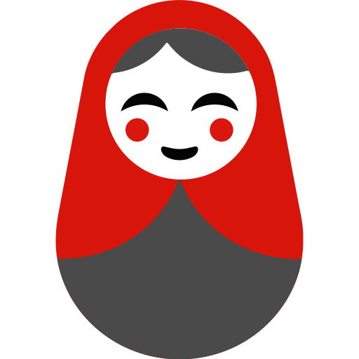
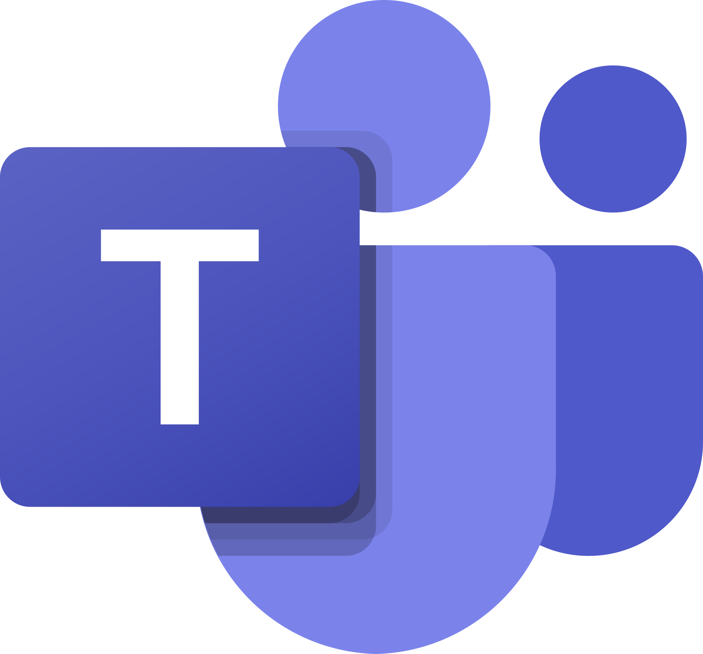
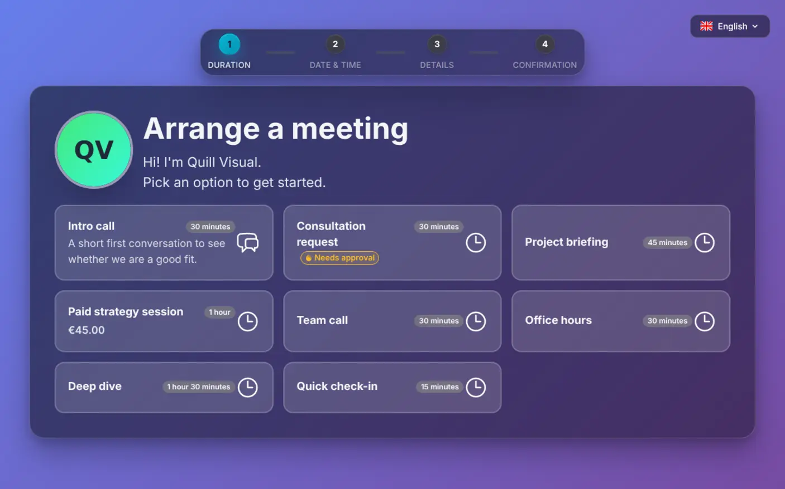
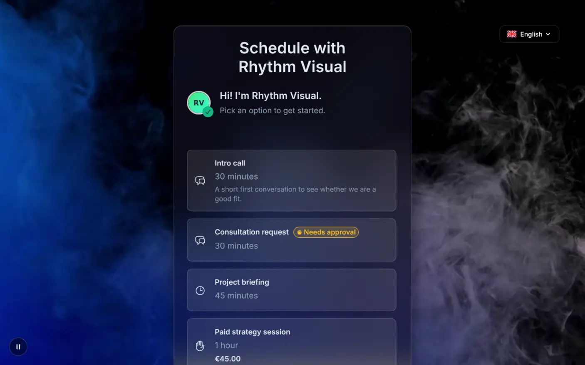
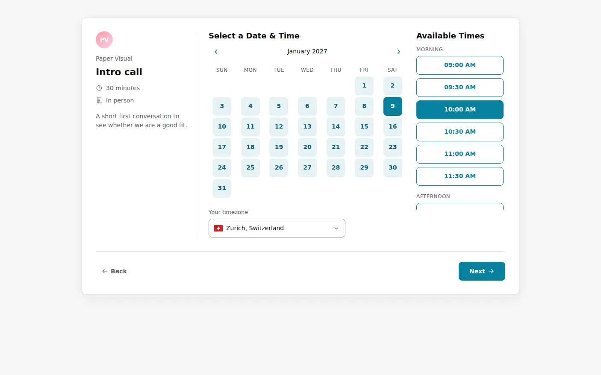
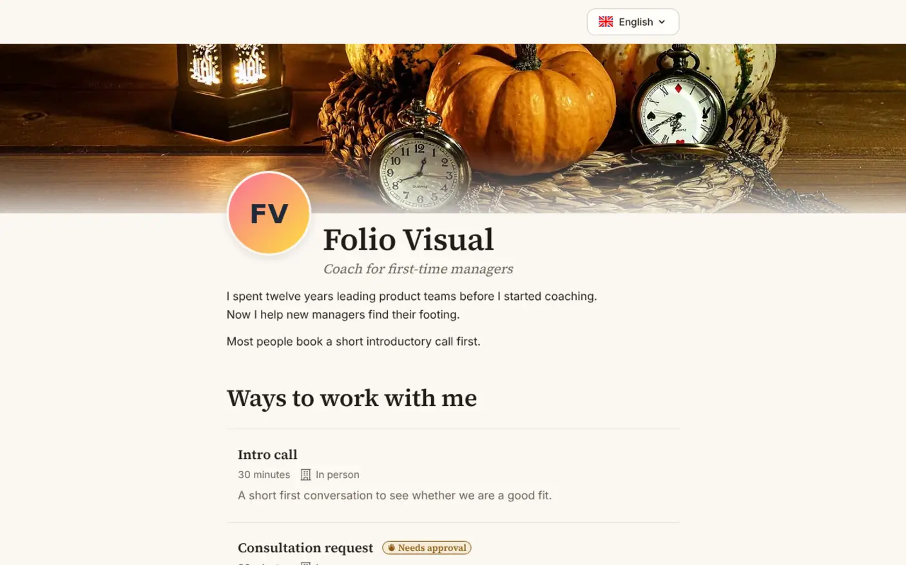

<p align="center">
  <a href="https://tymeslot.app?utm_source=github&utm_medium=readme&utm_campaign=core">
    <picture>
      <source media="(prefers-color-scheme: dark)" srcset="./priv/static/images/readme/logo-dark.svg" />
      
    </picture>
  </a>
</p>

<h3 align="center">Scheduling software that stays yours.</h3>

<p align="center">
  <b>The open-source, self-hostable alternative to Calendly and Cal.com.</b><br />
  Run it on your own server, or let us host it in the EU. Same code, no gated features.
</p>

<p align="center">
  <a href="LICENSE"></a>
  <a href="https://github.com/tymeslot/tymeslot/releases"></a>
  <a href="https://hub.docker.com/r/luka1thb/tymeslot"></a>
  <a href="https://github.com/tymeslot/tymeslot/stargazers"></a>
</p>

<p align="center">
  <a href="#self-host"><b>Self-host in one command</b></a> ·
  <a href="https://tymeslot.app?utm_source=github&utm_medium=readme&utm_campaign=core"><b>Try the cloud free</b></a>
</p>

<p align="center"><sub>
  <a href="#watch">Watch</a> &nbsp;|&nbsp;
  <a href="#features">Features</a> &nbsp;|&nbsp;
  <a href="#all-features">All features</a> &nbsp;|&nbsp;
  <a href="#self-host">Self-host</a> &nbsp;|&nbsp;
  <a href="#cloud-or-self-hosted">Cloud or self-hosted</a> &nbsp;|&nbsp;
  <a href="https://tymeslot.app/docs?utm_source=github&utm_medium=readme&utm_campaign=core">Docs</a> &nbsp;|&nbsp;
  <a href="#contribute">Contribute</a>
</sub></p>

<br />

<p align="center"><b>Syncs both ways with</b></p>
<p align="center">
  &nbsp;
  &nbsp;
  <picture><source media="(prefers-color-scheme: dark)" srcset="./priv/static/images/readme/apple-dark.svg" /></picture>&nbsp;
  &nbsp;
  &nbsp;
  &nbsp;
  &nbsp;
  &nbsp;
  
</p>

<p align="center"><b>Creates video rooms on</b></p>
<p align="center">
  &nbsp;
  &nbsp;
  &nbsp;
  &nbsp;
  &nbsp;
  &nbsp;
  
</p>

<br />

<a id="watch"></a>

## 🎬 Tymeslot in 84 seconds

https://github.com/user-attachments/assets/f7fdf4cc-5e47-4de5-9312-e3da01e9ce5f

<p align="center"><sub><a href="https://www.youtube.com/watch?v=XjDvnbdJH1Q">Watch in HD on YouTube →</a></sub></p>

## Booking themes

Every booking theme starts from a person and the way they like to be booked, and follows their story: its journey, its look and its voice. Each has a persona sheet saying who it is for and why it looks and behaves as it does.

<p align="center">
<a href="./docs/themes/quill.md"></a>
<a href="./docs/themes/rhythm.md"></a>
<a href="./docs/themes/paper.md"></a>
<a href="./docs/themes/folio.md"></a>
</p>

- **[Quill](docs/themes/quill.md)**: for consultants and professional services whose clients should feel they are booking someone established.
- **[Rhythm](docs/themes/rhythm.md)**: for creatives whose visitors should feel the atmosphere first: motion, mood, then a time.
- **[Paper](docs/themes/paper.md)**: for organisers who want no personality on the page, just clear, fast and in their colour, so people book and get on with their day.
- **[Folio](docs/themes/folio.md)**: for coaches, therapists and freelancers whose visitors should know who they are, what they do and whether they're a fit before they pick a date.

A new theme starts the same way, from its persona sheet: see [Start from a story](docs/THEME_DEVELOPMENT_GUIDE.md#start-from-a-story).

<a id="features"></a>

## ✨ Features

<table>
  <tr>
    <td width="50%" valign="top">
      
      <b>A booking page guests finish.</b> Pick a time, confirm, done. No account, their language, their time zone.
    </td>
    <td width="50%" valign="top">
      
      <b>Your look.</b> Four themes, custom colours and backgrounds, white-label.
    </td>
  </tr>
  <tr>
    <td valign="top">
      
      <b>On your website.</b> Inline, popup or floating button, signed and domain-locked.
    </td>
    <td valign="top">
      
      <b>Your server.</b> One container, Postgres included. Or Cloudron, Railway, or our cloud.
    </td>
  </tr>
</table>

<a id="all-features"></a>

## 📋 Everything in the box

No add-ons and no per-feature upsells: self-hosted gets all of it.

| | What you get |
|---|---|
| **Booking pages** | Four themes (Quill, Rhythm, Paper, Folio), custom colours and backgrounds, white-label. Guests need no account and see their own language and time zone. |
| **Meeting types** | Durations, custom questions, booking limits, approval before confirming, several locations per type for the guest to pick from. |
| **Availability** | Named schedules with hours, breaks and date overrides; buffers, minimum notice and booking window per type. |
| **Calendars** | Two-way sync with Google, Outlook, iCloud and any CalDAV server (Nextcloud, Radicale, Zimbra, Baikal, mailbox.org). A conflict anywhere blocks the slot everywhere. Full in-app calendar. |
| **Video & location** | Rooms created automatically on Google Meet, Teams, Zoom, Jitsi, MiroTalk, kMeet or Nextcloud Talk; in person, phone or a custom link. |
| **Emails** | Branded, responsive templates with an `.ics` invite, configurable reminders, and cancel or reschedule links that need no login. |
| **Automation** | `meeting_created`, `meeting_cancelled` and `meeting_rescheduled` webhooks (HMAC-signed) for n8n, Zapier, Make or your backend; Slack and Telegram notifications. |
| **Embed** | Inline, popup or floating button. Tokens are signed and domain-locked. |
| **Payments** | Optional paid bookings through Stripe Connect, off by default and fee-free for self-hosters. [Setup →](https://tymeslot.app/docs/stripe-self-hosting?utm_source=github&utm_medium=readme&utm_campaign=core) |
| **Sign-in & admin** | Email and password, Google, GitHub, generic OAuth/OIDC (Keycloak, Authentik, Okta, Azure AD). Toggle registration and password sign-in from `/admin` without a redeploy. |
| **Privacy & security** | No third-party trackers or pixels, credentials encrypted at rest, rate-limited public endpoints, CSRF protection and signed tokens. |
| **Languages** | English, German, French, Italian, Czech, Polish, Ukrainian, Brazilian Portuguese and Spanish, across the dashboard, booking pages and every email. |
| **Under the hood** | Elixir/OTP, Phoenix LiveView, PostgreSQL 14+, Oban. Supervised processes restart a failing sync instead of taking your booking page down. |

<a id="self-host"></a>

## 🚀 Self-host in one command

```bash
docker run --name tymeslot -p 4000:4000 \
  -e SECRET_KEY_BASE="$(openssl rand -base64 64 | tr -d '\n')" \
  -e PHX_HOST=localhost \
  -v tymeslot_data:/app/data -v tymeslot_pg:/var/lib/postgresql/data \
  luka1thb/tymeslot:latest
```

Open <http://localhost:4000>; the first account becomes admin. SMTP, TLS, Compose and external Postgres: **[Docker guide →](README-Docker.md)**

<p>
  <a href="https://www.cloudron.io/store/tymeslot.html"></a>
  <a href="https://railway.com/deploy/tymeslot"></a>
</p>

<a id="cloud-or-self-hosted"></a>

## ☁️ Cloud or self-hosted?

Same product either way. Self-hosted is not a trial edition: it gets every feature.

| | 🐳 Self-hosted | ☁️ Tymeslot Cloud |
|---|---|---|
| **Price** | Free, forever | Free plan · Pro at **€9/mo** |
| **Setup** | One Docker command | Sign up, nothing to install |
| **Hosting & data** | Your server, your database | Hosted in the EU |
| **Updates & backups** | You run them | Done for you |
| **Support** | Community, through [issues](https://github.com/tymeslot/tymeslot/issues) | Priority |
| | **[Self-host now ↑](#self-host)** | **[Try it free →](https://tymeslot.app?utm_source=github&utm_medium=readme&utm_campaign=core)**<br /><sub>7-day Pro trial, no card</sub> |

<a id="contribute"></a>

## ⭐ Star & contribute

A star is the biggest thing you can do to help others find Tymeslot. PRs and issues are welcome: start with [CONTRIBUTING.md](CONTRIBUTING.md), and report security issues through the [contact page](https://tymeslot.app/contact).

<a href="https://github.com/tymeslot/tymeslot/graphs/contributors">
  
</a>

<a href="https://star-history.com/#tymeslot/tymeslot&Date">
  <picture>
    <source media="(prefers-color-scheme: dark)" srcset="https://api.star-history.com/svg?repos=tymeslot/tymeslot&type=Date&theme=dark" />
    
  </picture>
</a>

## Licence

[GNU AGPLv3](LICENSE). The Tymeslot name and logo are trademarks of Diletta Luna OÜ; forks are welcome under their own name ([TRADEMARK.md](TRADEMARK.md)).

<p align="center"><sub>Made in Tallinn, Estonia 🇪🇪 · Cloud hosted in the EU 🇪🇺</sub></p>
