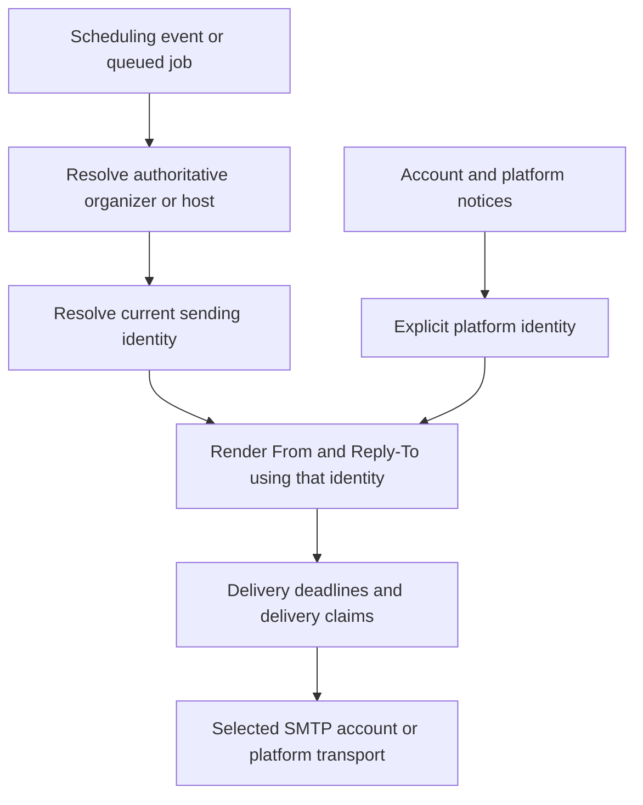

# Per user SMTP extension plan

## Overview

Give each individual user one configurable SMTP sending identity for scheduling notifications. The identity includes the SMTP host, port, transport security, username, password, From address, and From display name. Select the identity from the meeting organizer, poll host, or calendar event owner, regardless of the recipient.

The existing user ownership model is sufficient for this extension. Build on the current SMTP adapter, encrypted credential storage, shared email builders, and Oban delivery pipeline.

The estimated implementation effort is 11–19 engineer-days. Budget 15–25 engineer-days, including contingency, for one developer familiar with Elixir and Phoenix. Deliver in four compatible phases, with a usable booking-email release in phase 3 and full scheduling coverage in phase 4.

## Scope and behavior

### Included

- One SMTP configuration per user, with password or app-password authentication.
- From address and display name configured independently of the user's login address.
- Encrypted credentials, an authenticated settings form, a test email, activation, replacement, disablement, and deletion.
- The complete booking email lifecycle, including confirmations, reminders, cancellation, rescheduling, approvals, and guest/group variants.
- Poll messages, dashboard calendar invitations and updates, and booking-specific customer payment notices in the final phase.
- Clear configuration errors, bounded retries, sending-account isolation, and operator controls.

### Outside this extension

Organizations and memberships, SMTP OAuth, multiple identities per user, incoming email, per-user logos or colors, custom application domains, DNS provisioning, and a provider domain-verification service are separate features. The SMTP provider must authorize the configured From address and handle the domain's email authentication.

### Sending policy

| Message or setting state | Sending policy |
| --- | --- |
| Scheduling message with an enabled custom identity | Use the organizer's SMTP configuration and From identity. |
| No custom identity, or user explicitly disables it | Use the platform sender and transport. |
| Enabled custom identity fails credential decryption, authentication, TLS, DNS, or delivery | Report the failure through the existing job outcome machinery and user status. Preserve the selected identity; do not silently switch to the platform sender. |
| Signup, verification, password reset, account/security notices, integration health notices, admin alerts, subscription billing, or SMTP failure notices | Use the platform sender and transport. |
| Test message | Use the candidate SMTP identity and send only to the authenticated user's verified account email. |
| Scheduling job whose required owner no longer exists | Follow the applicable existing deletion/cancellation contract; never infer another user's identity or reuse retained credentials. |

Booking-specific customer payment notices include receipts, refunds, and payment-related booking outcomes where the current code sends them. Stripe account, payout, dispute, and platform subscription notices use the platform identity. Classify existing messages explicitly before routing them.

Disabling the deployment feature restores the platform policy for subsequent sends. Document that this is an operator-controlled change of sender; a send already in progress may finish with the identity it resolved.

## Architecture

### Configuration ownership

Introduce a small `Tymeslot.EmailSending` domain with a stable public context, its own schema, and a dedicated query module. Its public boundary owns settings validation, ownership checks, test-and-save operations, activation, and sender resolution. The web layer calls this context, following the repository's existing boundary rules.

Use an additive `user_smtp_settings` table with a unique foreign key to `users` and deletion cascade. Keep transport credentials separate from the global user authentication schema.

| Fields | Contract |
| --- | --- |
| `id`, `user_id` | One configuration per user. Derive the owner from the acting user when writing. |
| `host`, `port`, `security` | A hostname, an allowed port, and an explicit implicit-TLS or required-STARTTLS mode. |
| Encrypted username and password | Reuse the existing encryption/keyring facilities and register storage with the credential rotation sweep. Ordinary settings reads return redacted data. |
| `from_address`, `from_name` | Validated mailbox and bounded display name; reject header control characters at the domain boundary. |
| `enabled`, configuration revision, test revision/time | Enable only a successfully tested revision. Use optimistic concurrency to reject stale saves or activation. |
| Sanitized delivery status and last failure time | Keep actionable error codes without credentials or raw SMTP replies. Bound status writes to avoid updating the settings row for every successful recipient. |
| Timestamps | Support configuration lifecycle and safe operational reporting. |

Saving a blank password while editing preserves the current secret. A separate delete operation removes credentials. Never return stored passwords to the browser, put them in Oban arguments or email metadata, or include them in logs and error reports. Pass secrets only in the short-lived runtime transport configuration, with redacted inspection.

### Configuration lifecycle

For a new identity, validate a candidate and send a test message before saving it as a tested, disabled configuration. The user then enables that revision. A successful test means the relay accepted the message; it does not prove inbox delivery or domain authentication.

For an enabled identity, test a replacement candidate before atomically updating the stored configuration. Failed testing leaves the active configuration intact. A concurrent disable, delete, or edit must invalidate the pending save. Explicit disablement selects the platform sender and retains the saved settings; deletion removes the settings entirely.

Resolve current settings when each job runs. A queued reminder therefore uses the current enabled identity, rather than retaining an old password. Resolve once for a single job execution so its recipient copies use the same identity. Revalidate the destination for every new SMTP connection.

### Explicit sender context

Carry an explicit sender context through notification handling, rendering, and delivery. It identifies the message purpose, owner, selected From identity, and sending configuration revision. Pass the runtime transport separately into the task that calls `Mailer.deliver/2`.

Settings operations must scope reads and writes by the acting user inside the domain/query boundary. Internal sender resolution accepts only the owner established by a loaded resource or a validated scheduling snapshot. The recipient's email and submitted form owner IDs never select SMTP credentials.

Keep shared template defaults compatible for platform messages. Update From construction and sender-dependent Reply-To helpers together; changing From only after rendering would leave reply instructions based on the platform address. Preserve the existing booking reply destinations.

SMTP customization must preserve calendar event UIDs, sequence numbers, actual organizer addresses, current `METHOD:PUBLISH` behavior, and booking URL RSVP semantics. Changing an SMTP account must not create a new calendar event identity.

### SMTP transport safety and isolation

The current SMTP configuration was designed for trusted deployment environment variables. Treat user-supplied relay settings as a new security boundary.

- Require certificate validation and authenticated SMTP over implicit TLS or required STARTTLS. The per-user path must refuse missing AUTH rather than using the current adapter's unauthenticated-relay fallback.
- Start with public SMTP hosts and ports 465 and 587. Keep private relays, arbitrary ports, custom CA files, and disabled certificate validation out of the user form. Expand these only through a deliberate operator policy if required.
- Validate DNS answers for IPv4 and IPv6 and reject private, loopback, link-local, unspecified, and other non-public destinations. Connect to an approved address while retaining the original hostname for TLS SNI and certificate validation. Reuse the existing address policy where applicable; the HTTP pinning helper itself is not an SMTP transport.
- Prove approved-address connection support against the locked `gen_smtp` version before releasing any user-controlled connection, including test sends. A hostname check followed by an independent DNS lookup is insufficient. If the existing adapter cannot enforce the contract, adapt the socket boundary before enabling the feature.
- Keep connection and delivery deadlines, Oban as the retry authority, and the existing ambiguous-timeout and delivery-claim protections. SMTP does not provide an exactly-once delivery guarantee.
- Use an independently keyed circuit breaker for each user's configuration/revision, using the existing Registry and dynamic supervisor pattern. Do not key only by relay host or create atoms from user input. Expire idle breakers and align worker snooze behavior with their recovery policy.
- Bound test-send attempts and concurrent sends per owner. Preserve existing recipient-wide booking/poll limits; adding sender limits must not weaken recipient protection. A durable single-node reservation or cluster-aware mechanism is required if limits must hold across multiple nodes.

Authentication, sender rejection, and invalid settings need actionable user errors. Transient network and relay failures retain bounded retry behavior. Distinguish configuration rejection from permanent recipient rejection so a rejected From address does not mark every recipient undeliverable.

## Delivery phases

Each phase includes its behavior tests, documentation relevant to the phase, and passing repository checks before it ships. These are implementation milestones; a later task breakdown can assign individual files and work items.

### Phase 1 Add settings and secure transport foundations

**Status:** Implemented. The [foundation guide](../USER_SMTP.md) describes the
internal API and deployment flag. Validation passed: 27,508 default-suite
checks, the explicit migration rollback test, incremental Dialyzer, strict
Credo, formatting, and migration safety.

**Outcome:** A user-owned configuration domain, additive migration, encrypted storage/rotation integration, validation rules, and a tested secure SMTP connection boundary are available internally.

Add strict runtime configuration for `USER_SMTP_ENABLED=false`, with matching `.env.example` and applicable Docker/Compose documentation and wiring. This deployment control gates custom routing as well as UI access. Retain existing global SMTP/API-provider behavior for platform messages.

**Acceptance:** Ownership, concurrent updates, encryption/key rotation, deletion cascade, host/port validation, TLS/AUTH enforcement, approved-address connections, and secret redaction are covered. No user can activate or test the new path while the feature is disabled.

**Rollback:** Keep the additive table and disable the feature. A code rollback must not require deleting stored data.

**Estimate:** 3–5 engineer-days.

### Phase 2 Integrate booking sender resolution internally

**Status:** Implemented. Booking handlers share a nonsecret sender snapshot;
delivery rechecks its exact settings revision and uses a separate account
breaker. Guest failures retain retry/snooze outcomes and completed recipient
claims, including approval-release guests deferred to an existing outcome job.
Older jobs retain their existing required arguments; an optional boolean records
owed approval-release guest notices without retaining credentials.

Validation passed: 27,623 default-suite checks (420 expected exclusions), strict
Credo, incremental Dialyzer with no unused filters, warning-free compilation,
formatting, translation freshness, Sobelow, dependency audit, migration safety
and the compile-coupling gate. One existing 50 ms poll test flaked during a run
concurrent with linting; its isolated run and the complete same-seed rerun at
lower parallelism passed.

Ten owner connection slots reuse the existing monitored lock manager and are
node-local. Strict limits across nodes or lock-manager restarts require further
coordination before such a guarantee is offered. The [operator guide](../USER_SMTP.md)
describes routing, feature disablement and these operational limits. Dashboard
controls remain in phase 3.

**Outcome:** The complete booking email lifecycle can use an explicitly selected sender through existing jobs, templates, and delivery, with independent failure handling. It is ready for controlled internal use before exposing settings to users.

Include approval outcomes, reminders, rescheduling, cancellations, group seats, guests, and snapshot jobs. Reuse owner IDs already carried by notification details. Preserve per-recipient delivery claims and partial-send recovery. Platform messages explicitly retain the platform identity.

**Acceptance:** Two owners using the same SMTP host can send with separate accounts; one owner's failures do not block the other or platform email. Retry, queued-settings changes, sender-aware Reply-To, calendar attachment identity, and existing job argument compatibility are tested.

**Rollback:** Disable custom routing through the feature boundary. Previously queued jobs remain readable because credentials and new required arguments are not embedded in them.

**Estimate:** 3–5 engineer-days.

### Phase 3 Release SMTP settings for booking emails

**Status:** Implemented. Dashboard Profile now includes
feature-gated controls for asynchronous testing/saving, tested-revision
activation, disablement and confirmed deletion. Public forms remove stored
and submitted credentials; delivery status uses sanitized, revision-scoped
outcomes. Copy is translated into every supported locale.

**Validation:** The full suite passed 27,679 checks (29 doctests, 94 properties
and 27,556 tests), with 420 expected exclusions. Strict Credo, incremental
Dialyzer, formatting, Gettext freshness, security and migration checks passed.
Desktop and 320-pixel English/German layouts were visually verified.

The user deferred the external staging-account check. The local acceptance
flow uses the scripted TLS relay, including dashboard configuration, real
booking delivery and platform password recovery while custom SMTP is broken.
Complete a provider-backed staging send before deployment.

**Outcome:** A user can configure, test, enable, repair, disable, and delete their booking-email sender through the dashboard. This is the first public release with usable end-to-end value.

Add an Email sending section within dashboard settings, with host, port, TLS mode, username, write-only password, From address, and display name. Reuse existing form components, Gettext conventions, and domain validation. Perform connection work asynchronously so the LiveView stays responsive; keep the synchronous domain operation independently testable. Fetch settings after authentication using the repository's data-loading conventions.

Explain exactly which emails use custom SMTP. Show disabled, testing, enabled, and attention-required states and a sanitized last failure. The UI must distinguish relay acceptance from confirmed receipt. Save and activation results must refer to the same tested revision. Provide an explicit Use platform sender action.

**Acceptance:** LiveView tests cover authorization, secret-free rendering, blank-password edits, asynchronous errors, concurrent edits, enable/disable, and deletion. End-to-end tests cover a real booking through a scripted relay, default-sender regression behavior, and account recovery while custom SMTP is broken. Complete a staging delivery check using an operator-owned SMTP account and test recipients.

**Rollback:** Disable the feature to hide controls and restore platform routing. Keep credentials encrypted for later reactivation.

**Estimate:** 3–5 engineer-days.

### Phase 4 Complete scheduling notification coverage

**Outcome:** Poll messages, dashboard calendar invitation/update/cancellation messages, and booking-specific customer payment notices use the same sending policy. The UI describes the complete coverage.

Inventory each delivery entry point, including direct calls to `Delivery` and workers using `TransactionalEmailDelivery`, and classify its purpose explicitly. Preserve owner IDs in cancellation/event snapshots that outlive their original resource. Discard jobs whose required owner was deleted according to the established lifecycle contract; never retain SMTP credentials after account deletion to complete an old send.

**Acceptance:** Routing tests cover each message family, including direct-send worker paths, snapshots after resource deletion, and platform financial/security notices. Update user and operator documentation and rehearse disablement and reactivation with queued jobs.

**Rollback:** Revert the additional routing classifications and UI coverage text to the phase 3 policy, or disable the deployment feature.

**Estimate:** 2–4 engineer-days.

## Existing implementation anchors

| Boundary | Existing code to reuse or extend |
| --- | --- |
| SMTP configuration and transport | `lib/tymeslot/mailer/smtp_config.ex`, `smtp_adapter.ex` |
| Connectivity probe | `lib/tymeslot/mailer/smtp_probe.ex`; currently checks connectivity/TLS without authenticating or sending |
| Final mailer and deadline wrapper | `lib/tymeslot/mailer.ex`, `lib/tymeslot/emails/delivery.ex` |
| Shared From, logo, and Reply-To helpers | `lib/tymeslot/emails/shared/mjml_email.ex` |
| Organizer identity | `lib/tymeslot/notifications/content_builder.ex`, `notifications/email/calendar_event_details.ex` |
| Scheduling, snapshots, and retries | `lib/tymeslot/emails/email_scheduler/`, `lib/tymeslot/workers/email_worker.ex`, `transactional_email_delivery.ex` |
| Direct poll delivery | `lib/tymeslot/notifications/email/poll_emails.ex` |
| Encryption and rotation | `lib/tymeslot/security/encryption.ex`, `encrypted_storage.ex`, `credential_reencryption.ex` |
| Address validation and breaker patterns | `lib/tymeslot/security/dns_resolution.ex`, `lib/tymeslot/infrastructure/provider_breakers.ex` |
| Dashboard settings | `lib/tymeslot_web/live/dashboard/profile_settings_component.ex` and existing form components |
| SMTP integration fixtures | `test/support/fake_smtp_relay.ex`, `test/tymeslot/emails/smtp_delivery_test.exs`, `test/tymeslot/mailer/smtp_tls_transport_test.exs` |

## Validation and operational readiness

Use the existing scripted SMTP relay for real transport tests covering successful authentication, rejected credentials, unavailable AUTH, required STARTTLS, implicit TLS, certificate mismatch, timeout before sending, rejection of From/recipient, and ambiguous timeout after DATA. Extend that fixture only where needed. Test concurrent users, DNS rebinding defenses, feature-off behavior, credential rotation, and application restart with queued jobs.

Use a test-specific destination policy and test CA for loopback fixtures; production user settings must not acquire a general private-address or certificate-validation bypass. Keep settings reads redacted and verify that captured logs and serialized job arguments contain no credentials.

Generate the migration using the repository's Mix task. Follow its query-module ownership, context authorization, type/documentation, test-tag, Gettext, and Core/SaaS boundary conventions. Run targeted unit/integration/LiveView tests during each phase, then the required final checks: `mix test`, `mix credo --strict`, `mix dialyzer`, and `mix format --check-formatted`. Any new icons must use the required Google Material Icons source.

Document SMTP provider prerequisites, app-password use, exact message coverage, TLS modes, test-send meaning, error recovery, key rotation, and feature rollback. Expose sanitized owner/configuration identifiers and delivery outcomes for operations; do not log credentials or full SMTP conversations. No per-user SMTP environment variables are introduced: each user's settings belong in encrypted database storage.

Worker state remains durable in Oban and configuration in PostgreSQL. A restart rebuilds circuit breakers and sender runtime state lazily. It must not lose credentials, invalidate queued jobs, replay completed delivery claims, or create an unbounded retry loop. Limit repeated user error notices and send them through the platform transport.

## Defaults and optional decisions

Proceed with the sending policy above, password/app-password authentication, standard public relay ports, and the existing email visual design. These defaults support implementation without an additional approval step.

Optional decisions that would change scope are private/nonstandard SMTP relays, OAuth-only mail accounts, and a requirement to brand account/security mail as well as scheduling messages. The transport boundary proof in phase 1 is the principal technical dependency; if it requires replacing substantial adapter behavior, revisit the upper estimate before exposing the feature.
